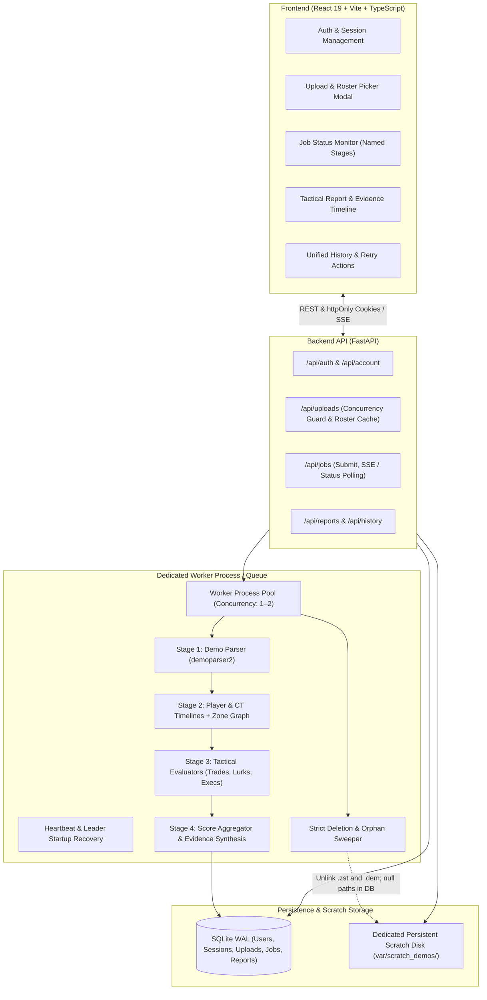

# CS2 FACEIT Baiting Analyzer — Technical Architecture

**Document Version:** 2.1 (Production-Ready Technical Blueprint)
**Target Product Scope:** `docs/plan.md` (v0.2 with Architecture 2.1 refinements)
**Selected Architecture Option:** Option 1 — Decoupled Full-Stack (FastAPI + React / TypeScript)
**Database:** SQLite with Write-Ahead Logging (WAL) and `busy_timeout = 5000`
**Session & Auth Strategy:** httpOnly Cookie-based Sessions backed by a persistent `SESSIONS` table
**PDF Engine:** ReportLab (Pure Python, zero external GTK/C library dependencies on Windows)

## 1. System Overview

The **CS2 FACEIT Baiting Analyzer** is an evidence-first tactical analysis platform. It allows users to upload a CS2 match demo (`.dem` or `.dem.zst` on `de_mirage`, up to 350 MB), select a player by SteamID, and run an automated heuristic pipeline that analyzes all T-side rounds. The system outputs an explainable 1–100 baiting score alongside timestamped, verifiable evidence distinguishing facts from tactical interpretations.



## 2. Technology Stack & Key Decisions

| Layer | Chosen Technology | Architecture Decisions & Rationale |
| :--- | :--- | :--- |
| **Backend Framework** | **Python 3.12+ / FastAPI + Pydantic v2** | High throughput async I/O with strict type validation. Pinned to stable Python 3.12–3.14. |
| **Auth & Sessions** | **httpOnly Secure Cookies + `SESSIONS` Table** | Session tokens stored in httpOnly, SameSite cookies. Server-side revocation on logout/deletion; compatible with native `EventSource` (SSE). |
| **Database** | **SQLite (WAL mode)** via **SQLAlchemy 2.0** | Configured with `PRAGMA journal_mode = WAL;` and `PRAGMA busy_timeout = 5000;` to eliminate locking conflicts between API and worker processes. |
| **Demo Parser** | **`demoparser2`** | High-performance Rust-backed CS2 demo parser for tick data, coordinates, and events. |
| **Data Processing** | **`polars` & `numpy`** | Vectorized tick filtering, spatial distance calculations, and coordinate clustering. |
| **Worker Engine** | **Dedicated Worker Process Pool + Heartbeat** | Separate process pool capped at 1–2 concurrent jobs. Worker tracks periodic heartbeat timestamps; API never kills healthy running jobs. |
| **PDF Generation** | **ReportLab** | Selected as the single PDF engine. Pure Python, deterministic layout, zero external GTK/Pango dependencies on Windows, no headless browser overhead. |
| **Frontend UI** | **React 19 + TypeScript + Vite + Tailwind CSS** | Clean dark-mode tactical dashboard with responsive evidence filtering and charts. |

## 3. High-Level Directory Structure

```text
FronProject/
├── docs/
│   ├── plan.md                     # Product scope & MVP requirements
│   └── architecture.md             # Technical architecture (this document)
├── backend/
│   ├── app/
│   │   ├── api/                    # API endpoints
│   │   │   ├── auth.py             # Register, login, logout, me
│   │   │   ├── account.py          # Account deletion (cancels jobs & clears files)
│   │   │   ├── uploads.py          # Upload, validate, semaphore roster extract, TTL check
│   │   │   ├── jobs.py             # Submit job, status polling / SSE stream
│   │   │   ├── reports.py          # Get report, export PDF/JSON, delete report
│   │   │   └── history.py          # Unified history & delete failed/completed jobs
│   │   ├── core/
│   │   │   ├── config.py           # App settings, scratch paths, quotas, reverse-proxy IPs
│   │   │   ├── security.py         # Argon2id password hashing & secure session tokens
│   │   │   └── weights.py          # Versioned scoring weights & heuristic thresholds
│   │   ├── db/
│   │   │   ├── base.py             # SQLAlchemy DeclarativeBase
│   │   │   ├── models.py           # User, Session, Upload, Job, Report ORM models
│   │   │   └── session.py          # Sessionmaker with WAL & busy_timeout = 5000
│   │   ├── services/
│   │   │   ├── auth_service.py     # User auth & session lifecycle
│   │   │   ├── upload_service.py   # Upload tracking, semaphore parsing, TTL cleanup
│   │   │   ├── job_service.py      # Worker queue, heartbeat updates, leader startup recovery
│   │   │   ├── pdf_service.py      # ReportLab PDF generator with mandatory disclaimers
│   │   │   └── analysis/           # CS2 tactical analysis pipeline
│   │   │       ├── parser.py            # demoparser2 extraction & round boundary filter
│   │   │       ├── zone_graph.py        # Mirage 15-zone tactical map & routing graph
│   │   │       ├── timeline.py          # T-side player and CT rotation timeline reconstruction
│   │   │       ├── trade_detector.py    # 800u / 3s window evaluator with teammate trade logic
│   │   │       ├── execution_detector.py# Utility + spatial site entry detection
│   │   │       ├── lurk_analyzer.py     # Lurk kills vs confirmed rotating CTs
│   │   │       └── scoring.py           # Dropped sub-signal renormalization & low evidence rules
│   │   └── main.py                 # FastAPI app entrypoint
│   ├── tests/
│   │   ├── fixtures/               # Golden parsed JSON mock fixtures for unit tests
│   │   ├── test_trade_detector.py  # Tests for trade windows, team trades, non-player deaths
│   │   ├── test_execution.py       # Tests for utility + spatial execution detection
│   │   ├── test_scoring.py         # Tests for zero-data sub-signal dropping & renormalization
│   │   └── test_upload_flow.py     # Tests for quotas, decompression caps & cleanup
│   ├── requirements.txt            # Python dependencies
│   └── pyproject.toml
└── frontend/
    ├── src/
    │   ├── api/                    # Typed API client with credential cookies
    │   ├── components/             # Reusable UI elements
    │   │   ├── layout/             # Navigation, quota indicator, footer
    │   │   ├── upload/             # Dropzone, validation feedback, roster picker modal
    │   │   ├── report/             # ScoreHero, SubSignalCards, Timeline, EvidenceItem
    │   │   └── history/            # HistoryTable with retry & delete actions
    │   ├── pages/                  # Page containers
    │   │   ├── LoginPage.tsx
    │   │   ├── RegisterPage.tsx
    │   │   ├── UploadPage.tsx
    │   │   ├── JobStatusPage.tsx
    │   │   ├── ReportPage.tsx
    │   │   └── HistoryPage.tsx
    │   ├── types/                  # TypeScript interfaces matching backend models
    │   ├── App.tsx
    │   └── main.tsx
    ├── package.json
    ├── tailwind.config.js
    ├── tsconfig.json
    └── vite.config.ts
```

## 4. Database Schema & Data Models

The relational schema implements full session management, upload lifecycle tracking, and a unified history model linking jobs and reports.

```mermaid
erDiagram
    USERS ||--o{ SESSIONS : has
    USERS ||--o{ UPLOADS : owns
    USERS ||--o{ JOBS : owns
    JOBS ||--o| REPORTS : produces

    USERS {
        text id PK "UUID"
        text email UK
        text hashed_password
        datetime created_at
        datetime updated_at
    }

    SESSIONS {
        text id PK "Token Hash"
        text user_id FK
        datetime created_at
        datetime expires_at "7-day sliding TTL"
    }

    UPLOADS {
        text id PK "UUID"
        text user_id FK
        text original_filename
        text scratch_path "Nullable after cleanup"
        text decompressed_path "Nullable after cleanup"
        text match_name
        text map_name
        text cached_roster "JSON: [{steam_id, name}]"
        integer file_size_bytes
        datetime created_at
        datetime expires_at "1-hour TTL"
    }

    JOBS {
        text id PK "UUID"
        text user_id FK
        text upload_id FK
        text match_name
        text selected_steam_id
        text player_nickname
        text app_version
        text status "pending | processing | completed | failed"
        text stage "parsing | timelines | analyzing | generating"
        datetime heartbeat_at "Updated every 10s by worker"
        text error_message
        text failing_stage
        datetime created_at
        datetime completed_at
    }

    REPORTS {
        text id PK "UUID"
        text job_id FK UK
        text user_id FK
        text match_name
        text player_nickname
        text player_steam_id
        integer baiting_score "1..100"
        text confidence "low | medium | high"
        boolean insufficient_evidence
        text sub_signals "JSON"
        text evidence_timeline "JSON"
        text skipped_rounds "JSON"
        text config_snapshot "JSON"
        text app_version
        text weights_version
        text map_version
        datetime created_at
    }
```

### Database Initialization Parameters
```python
# SQLite configuration in app/db/session.py
from sqlalchemy import create_engine, event

engine = create_engine(
    "sqlite:///./var/app.db",
    connect_args={"timeout": 15},  # Wait up to 15s for locks
)

@event.listens_for(engine, "connect")
def set_sqlite_pragma(dbapi_connection, connection_record):
    cursor = dbapi_connection.cursor()
    cursor.execute("PRAGMA journal_mode = WAL;")
    cursor.execute("PRAGMA busy_timeout = 5000;")
    cursor.execute("PRAGMA synchronous = NORMAL;")
    cursor.close()
```

## 5. Tactical Analysis Engine & Heuristics

### 5.1 Mirage Zone Graph: 15 Connected Tactical Zones
To reflect genuine tactical routing without over-merging physically separate locations, Mirage is partitioned into **15 contiguous zones** matching `docs/plan.md` §3.5:
1. `T Spawn`
2. `Top Mid / T Roof`
3. `Lower Mid`
4. `Underpass`
5. `Catwalk / Short`
6. `Connector`
7. `Window (Sniper's Nest)`
8. `Ladder Room`
9. `A Ramp`
10. `Palace`
11. `A Site`
12. `CT Spawn`
13. `B Site`
14. `B Apartments`
15. `Market / Kitchen`

* **Zone Rules:** A-side transitions (Jungle) are grouped with Connector/A-Site; B-side Market/Kitchen is strictly isolated from A-side. Every zone is contiguous and connected by valid walkable navigation edges.
* **Spike & Nav Mesh Fallback:** A 1-day spike tests extracting polygon bounds from `de_mirage.nav`. If the binary structure introduces parsing hurdles, the system falls back to 2D polygon bounding lookups (`shapely`) defining the 15 zones.

### 5.2 Tactical Heuristics & Rules

#### 1. Missed Trade Rule
* **Candidate Window:** Teammate dies within **3.0 seconds** and spatial Euclidean distance $\le$ **800 units** from the selected player.
* **Exclusions:** Deaths caused by **fall damage, bomb explosions, world damage, or team kills** are excluded.
* **Outcomes:**
  * **Traded by Selected Player:** Selected player kills the teammate's killer within 3.0 s.
  * **Traded by Teammate:** Another teammate kills the killer within 3.0 s (counted as a team trade; **not** a missed trade for the selected player).
  * **Missed Trade:** Teammate dies, selected player was alive and within 800 units, but neither the player nor any teammate trades the killer within 3.0 s.

#### 2. Execution Detection Rule
*(Architecture 2.1 required to change it: see `docs/plan.md` §3.4)*
$$\text{Execution} = \text{Utility Condition} \land (\text{Approach Vector} \lor \text{Site Clustering})$$
Where:
1. **Utility Condition (Required):** $\ge 2$ smokes or flashes deployed toward the site within a 6-second window.
2. **Spatial Signal (At least one):**
   * *Approach Vector:* $\ge 3$ Ts moving along approach edges into the site zone within 5 seconds.
   * *Site Clustering:* $\ge 3$ Ts present in the site zone or its entry bottleneck (Ramp or Apps) concurrently.
* **Known Limitation:** Utility-free site rushes are classified as fast defaults/rushes, not executions.
* **Participation:** Selected player was present in or advancing along the execution route during the execute window.

#### 3. Lurk Effectiveness & CT Rotation Tracking
* In Stage 2, the pipeline builds timelines for **both** the selected player and all 5 defending CTs.
* Initial CT anchor sites are determined during the first 25 seconds of the round.
* A CT is tagged as a **rotator** once they vacate their initial anchor site toward the active T-pressured site.
* Lurk kills are credited when the selected player operates in an isolated zone and eliminates a confirmed rotator.

#### 4. Death Order & Context Guardrails
* Surviving longer is **not** penalized by default.
* Late survival is only flagged if all of the following conditions hold:
  1. Selected player is the last alive or dies last.
  2. The team had zero trades in the round.
  3. **Exclusion 1: Post-Plant Situations.** If the bomb was planted by Ts, late survival is legitimate objective defense and is **not** flagged.
  4. **Exclusion 2: Save Situations.** If $\ge 3$ teammates are dead and the round is statistically unwinnable, saving equipment is legitimate play and is **not** flagged.
* **Entry Fragging Recognition:** Dying first within the first 30 seconds inside an entry zone (e.g., A Site, B Apps, Palace) is explicitly classified as an entry attempt, not a baiting indicator.

#### 5. Skipped Rounds vs Failed Jobs
* **Skipped Rounds:** Rounds where the player disconnected or was replaced by a bot are skipped and appended to `skipped_rounds` in the report.
* **Job Failure Semantics:** A job **fails** only if:
  1. Selected SteamID is not present in the demo.
  2. **Zero analyzable T rounds remain** in the match.
  3. Demo file is corrupted or unreadable.
* Otherwise, the job completes successfully, noting skipped rounds in the header.

## 6. Score Design & Missing Data Handling

### 6.1 Sub-Signal Definitions & Bounds
Every active sub-signal is strictly bounded in the range $[0.0, 1.0]$. To avoid double-penalizing lurkers who are by definition absent from team executions, **lurk rounds are excluded from the execution denominator**, and lurk impact is treated as a **mitigating term**:

| Sub-signal | Metric Definition | Normalization Formula | Bound |
| :--- | :--- | :--- | :--- |
| **$S_{\text{trade}}$** | Missed trades per trade opportunity | $\frac{\text{Missed Trades}}{\text{Total Trade Opportunities}}$ | $[0.0, 1.0]$ |
| **$S_{\text{exec}}$** | Absence from team executions (non-lurk rounds) | $1.0 - \frac{\text{Participated Executions}}{\max(1, \text{Executions in Non-Lurk Rounds})}$ | $[0.0, 1.0]$ |
| **$S_{\text{death}}$** | Uncontributed late deaths (non-save, non-plant) | $\min\left(1.0, \frac{\text{Flagged Late Rounds}}{N_{\text{analyzed\_rounds}}}\right)$ | $[0.0, 1.0]$ |
| **$M_{\text{lurk}}$ (Mitigation)** | Rotator impact mitigation during isolated play | $\min\left(1.0, \frac{\text{Kills on Rotators}}{\max(1, \text{Isolated Rounds})}\right)$ | $[0.0, 1.0]$ |

### 6.2 Minimum Sample Thresholds & Weight Renormalization
To prevent small samples (e.g., 1 missed trade producing $S_{\text{trade}} = 1.0$) from skewing the report:
* **Minimum Sample Thresholds:**
  * $S_{\text{trade}} = \text{no\_data}$ if $\text{Total Trade Opportunities} < 3$.
  * $S_{\text{exec}} = \text{no\_data}$ if $\text{Executions in Non-Lurk Rounds} < 3$.
  * $M_{\text{lurk}} = \text{no\_data}$ if $\text{Isolated Rounds} < 2$ (neutral; 0 penalty).
  * $S_{\text{death}} = \text{no\_data}$ if $N_{\text{analyzed\_rounds}} < 6$.
* **Weight Renormalization:** Dropped sub-signals are excluded from the primary score calculation, and active primary sub-signals ($S_{\text{trade}}, S_{\text{exec}}, S_{\text{death}}$) are renormalized so their weights sum to 1.0:
  $$w_i' = \frac{w_i}{\sum_{j \in \text{active}} w_j}$$
  Default base weights: $w_{\text{trade}} = 0.45, w_{\text{exec}} = 0.35, w_{\text{death}} = 0.20$.
* **Score with Lurk Mitigation:** Lurk output mitigates suspicion by up to 15 points without penalizing non-lurkers:
  $$B_{\text{raw}} = 100 \times \sum_{i \in \text{active}} w_i' S_i - 15 \times M_{\text{lurk}}$$
  $$B = \text{clamp}(1, 100, \text{round}(B_{\text{raw}}))$$
* **Report Presentation:** Sub-signals with insufficient samples are listed under "No Applicable Situations / Insufficient Sample" and do not distort suspicion.

### 6.3 Low-Evidence Guardrail
Because $S_{\text{death}}$ is almost always active, the low-evidence guardrail specifically checks the depth of match play and informative signals:
* If $N_{\text{analyzed\_rounds}} < 6$ OR fewer than 2 *informative* sub-signals are active ($S_{\text{trade}}, S_{\text{exec}}, M_{\text{lurk}}$):
  * Final score is capped to a minimal baseline ($< 25$).
  * Report confidence is forced to `"low"`.
  * `insufficient_evidence: true` is set.
  * A prominent alert banner is rendered in the UI and exports stating that insufficient evidence exists to evaluate player patterns.

## 7. Storage, Worker Engine & Quota Protection

### 7.1 Dedicated Worker Process & Heartbeat Recovery
1. **Worker Process Pool:** Jobs run in a dedicated worker process pool with concurrency strictly limited to **1–2 jobs**.
2. **Heartbeat:** Every 10 seconds, the active worker updates `JOBS.heartbeat_at = datetime.utcnow()`.
3. **Leader Startup Recovery:**
   * Executed solely by the **worker leader process** on boot (never by API worker processes).
   * Queries `JOBS` where `status = 'processing'` AND (`heartbeat_at IS NULL` OR `heartbeat_at < NOW() - 60s`).
   * Marks these jobs as `failed` with error message `"Worker interrupted by server restart"`.
   * Sweeps `var/scratch_demos/` for orphan directories older than 1 hour.

### 7.2 Upload Semaphore & Scratch Disk Quotas
1. **Roster Extraction Concurrency Guard:** The API route `/api/uploads` protects demo parsing and decompression using an `asyncio.Semaphore(1)` to prevent CPU/memory exhaustion in API workers.
2. **Disk Quota Limits:**
   * Max **1 active upload** per user account simultaneously.
   * Maximum compressed upload size: **350 MB**.
   * Maximum decompressed stream size: **1.2 GB** (enforced via streaming check in both roster extraction and Stage 1).
   * Total scratch quota check: Reject uploads with `507 Insufficient Storage` if host free disk space $< 5\text{ GB}$ or `var/scratch_demos/` $> 10\text{ GB}$.
3. **Zero-Retention Cleanup:**
   * When a job finishes (success or failure), both `.zst` and `.dem` files are unlinked in a `finally` block.
   * `UPLOADS.scratch_path` and `UPLOADS.decompressed_path` are set to `NULL` in the database.
   * A periodic cleanup task unlinks expired uploads ($> 1$ hour old).

### 7.3 Rate Limiting & Reverse Proxy Support
* API rate limiting uses `slowapi` with trusted proxy headers (`X-Forwarded-For`), configured with `forwarded_allow_ips = ["127.0.0.1"]` (or CIDR blocks).
* Max 5 uploads per minute per IP; max 10 completed demo analyses per user per day.

## 8. API Specification

### Authentication & Account (Cookie-based Sessions)
* `POST /api/auth/register` — Create user account `{ email, password }`.
* `POST /api/auth/login` — Authenticate; creates session row in `SESSIONS` and sets `httpOnly`, `SameSite=Lax`, `Secure` session cookie.
* `POST /api/auth/logout` — Deletes session row from `SESSIONS` and clears cookie.
* `GET /api/auth/me` — Return authenticated user profile.
* `DELETE /api/account` — Cancels active jobs, unlinks scratch files, and cascade-deletes user, sessions, uploads, jobs, and reports.

### Uploads & Roster Extraction
* `POST /api/uploads` — Upload `.dem` or `.dem.zst` (max 350 MB) + optional `match_name`.
  * Checks user quota, host disk quota, and decompressed stream cap (1.2 GB).
  * Runs roster extraction via semaphore guard; caches player roster.
  * Returns `201 Created`:
    ```json
    {
      "upload_id": "c1a2...",
      "match_name": "Mirage 2026-10-12, 13-9",
      "map_name": "de_mirage",
      "expires_at": "2026-10-13T01:45:00Z",
      "players": [
        { "steam_id": "76561198000000001", "name": "s1mple" },
        { "steam_id": "76561198000000002", "name": "ZywOo" }
      ]
    }
    ```

### Jobs
* `POST /api/jobs` — Submit analysis job with `{ "upload_id": "c1a2...", "steam_id": "76561198000000001" }`.
  * Verifies upload ownership and 1-hour TTL.
  * Returns `202 Accepted` with `{ "job_id": "j9b3...", "status": "pending", "stage": "Parsing demo" }`.
* `GET /api/jobs/{job_id}` — Status polling endpoint.
* `GET /api/jobs/{job_id}/stream` — Native Server-Sent Events (`text/event-stream`) for live stage progress.

### Reports & Unified History
* `GET /api/history` — Unified list of all analysis runs (completed reports and failed jobs):
  ```json
  [
    {
      "job_id": "j9b3...",
      "report_id": "r4e1...",
      "status": "completed",
      "match_name": "Mirage 2026-10-12, 13-9",
      "player_nickname": "s1mple",
      "baiting_score": 38,
      "confidence": "medium",
      "app_version": "0.1.0",
      "created_at": "2026-10-13T00:50:00Z"
    },
    {
      "job_id": "j9b4...",
      "report_id": null,
      "status": "failed",
      "match_name": "Mirage vs NaVi",
      "player_nickname": "flamie",
      "failing_stage": "Analyzing rounds",
      "error_message": "Zero analyzable T-side rounds found in match.",
      "app_version": "0.1.0",
      "created_at": "2026-10-13T00:40:00Z",
      "retryable": true
    }
  ]
  ```
* `DELETE /api/history/{job_id}` — Deletes job (failed or completed), cancels processing if running, unlinks scratch files, and cascades to report.
* `DELETE /api/history` — Clears all history runs and reports for the user.
* `GET /api/reports/{id}` — Fetch full report JSON.
* `GET /api/reports/{id}/export/json` — Export report as JSON file.
* `GET /api/reports/{id}/export/pdf` — Export report as PDF using ReportLab with mandatory disclaimers and version stamps.

## 9. Phased Implementation Roadmap

* **Phase 1: Foundation & Session Auth**
  * Set up SQLite with WAL and `busy_timeout = 5000`.
  * Implement `SESSIONS` table, httpOnly cookie auth, and registration/login/logout/account deletion.
  * Add reverse-proxy rate limiting and disk quota guards.
* **Phase 2: Uploads, Parser & Validation Fixtures**
  * Implement `/api/uploads` with decompression limits (1.2 GB) and semaphore-guarded roster extraction.
  * Set up mock parsed demo JSON fixtures (`tests/fixtures/`) for unit tests.
  * Time-box 1-day spike for Mirage `.nav` file parsing vs 15-zone polygon mapping fallback.
* **Phase 3: Worker Queue & Tactical Evaluators**
  * Set up dedicated worker process with heartbeat reporting and leader startup recovery.
  * Implement trade opportunity evaluator (800u, 3s window, teammate trade check, non-player death filter).
  * Implement execution detection (utility + independent spatial check).
  * Implement CT rotation tracking and lurk evaluator.
  * Implement death-order contextual rules (excluding post-plants and saves).
* **Phase 4: Scoring, Report Persistence & Zero-Retention Cleanup**
  * Implement bounded sub-signals, missing-data weight renormalization, and low-evidence guardrail.
  * Implement zero-retention unlinking of `.zst` and `.dem` files and nullifying DB paths.
  * Implement ReportLab PDF generator.
  * Expose unified `GET /api/history` and `DELETE /api/history/{job_id}` supporting failed runs.
* **Phase 5: Frontend Experience & Verification**
  * Scaffold React 19 + Vite + Tailwind CSS dashboard.
  * Implement upload dropzone and player roster modal.
  * Build live stage monitor (via SSE or status polling).
  * Build interactive tactical dashboard (score card, evidence filters, facts vs interpretations).
  * Test with validation demos and golden fixtures.
