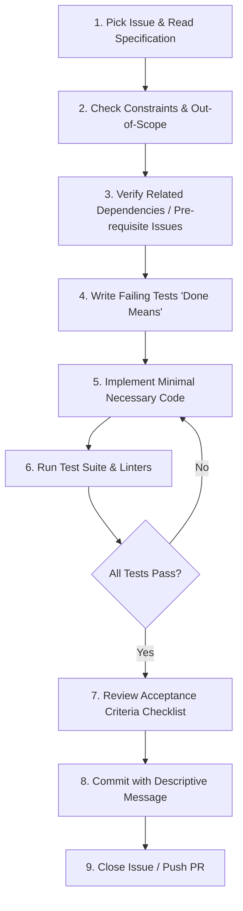

# Issue Flow & Structure Specification

This document defines how tasks and issues are structured, interpreted, and executed in this project. It is modeled after production-grade, evidence-driven issue specifications.

## 1. Anatomy of a Standard Issue

Every GitHub issue in this repository follows a rigorous structure to eliminate ambiguity before implementation begins:

```markdown
# <Number>. <Title>

### Goal
<One to two sentences stating the user capability or system invariant unlocked by this task.>

### Acceptance Criteria
- **Data & Models**: New fields, types, nullability, enums, indices, and defaults (including future-proofing rationale).
- **Ingestion / Creation**: Input validation rules, permission checks, error responses, handling of empty/whitespace input.
- **State Transitions & Mutations**: Who can update/delete, lifecycle restrictions (e.g., mutable vs. frozen fields), permission predicates.
- **Viewing & UI**: Display expectations, role-based visibility, distinction of edge states (unassigned, missing data, low evidence).

### Done Means
- Specific scenarios that must be covered by automated tests.
- Full test suite passes without regressions (`pytest`).
- Code linting and typing checks pass cleanly.

### Out of Scope
- Explicit list of related features, edge cases, or optimizations deliberately excluded to prevent scope creep.
- References to subsequent issues that will address deferred items.

### Constraints
- Architectural layer placement (e.g., `app/services/analysis/`, `app/api/`).
- Dependency rules ("No new dependencies without approval").
- Centralized utilities/predicates (e.g., permissions, error handlers) that must be imported rather than re-implemented inline.
- Cross-references to decisions in `docs/architecture.md` and `docs/plan.md`.
```

## 2. Issue Lifecycle & Execution Flow

When an engineer or AI agent picks up an issue, they must follow this sequential flow:



### Step 1: Pre-Implementation Analysis
1. Read the issue's **Goal** and **Acceptance Criteria** thoroughly.
2. Review the **Constraints** and **Out of Scope** sections. Do not build items listed under Out of Scope.
3. Identify existing models, services, or permission predicates to reuse. Never duplicate existing logic in a new location.

### Step 2: Test-Driven Verification ("Done Means")
1. Look at the specific test requirements in **Done Means**.
2. Write unit/integration tests covering:
   - Happy path.
   - Validation failures (e.g. non-member, invalid coordinates, decompression limit breach).
   - Lifecycle/frozen state rules (e.g. mutations allowed before completion but frozen after).
3. Confirm tests fail before implementation (if writing tests first).

### Step 3: Implementation
1. Implement the minimal necessary changes required to satisfy the acceptance criteria.
2. Adhere strictly to the stated constraints (e.g. pure Python ReportLab for PDF, semaphore-guarded parsing, zero-retention demo unlinking).
3. Do not add external dependencies unless explicitly requested.

### Step 4: Verification & Criteria Audit
1. Run the entire test suite: `pytest`.
2. Verify linter and typing pass cleanly.
3. Read the acceptance criteria checklist line by line. Verify that every single bullet is fulfilled.

### Step 5: Clean Commit & Reference
1. Commit changes with a descriptive conventional commit message referencing the issue number (e.g., `feat(analysis): implement trade opportunity detection (#18)`).
2. Ensure no scratch files, test binaries, or untracked temporary files are left in the working tree.
